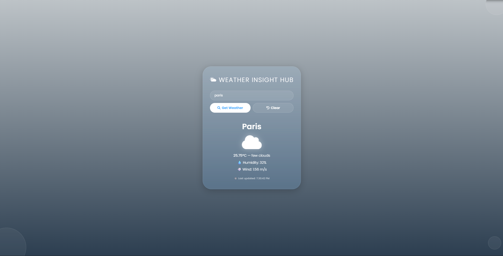

# Weather Insight Hub

A modern, feature-rich weather dashboard built with vanilla JavaScript, CSS3 Glassmorphism, and the OpenWeatherMap API. Designed with a sleek "liquid glass" interface, smooth UI transitions, and real-time weather analytics.




## Live Demo
Check out the live application here:  
[https://jcake-s.github.io/Weather-Insight-Hub/](https://jcake-s.github.io/Weather-Insight-Hub/)

---

## Features

* **Liquid Glassmorphism UI:** Features a translucent, frosted-glass container with dynamic background blur, soft gradients, and floating decorative liquid drops.
* **Dynamic Weather Themes:** The app background smoothly shifts and changes gradients depending on the current weather condition (Rain, Sunny/Clear, Clouds, Mist, Snow).
* **Persistent Storage (`localStorage`):** Automatically remembers and reloads the last searched city when you open or refresh the app.
* **Smart Weather Advisories:** Automatically triggers real-time warning badges for hazardous conditions like high humidity (>80%) or high wind speeds (>10 m/s).
* **Animated Icons:** Integrates color-responsive FontAwesome icons equipped with subtle pulse animations.
* **Fluid Transitions & Loaders:** Features a custom loading spinner and smooth fade-in animations for search results.
* **Responsive Design:** Fully optimized layout that scales seamlessly from desktop monitors down to mobile phone screens.

---

## 🛠️ Tech Stack

* **HTML5** (Semantic layout, accessibility support)
* **CSS3** (Flexbox, CSS variables, keyframe animations, backdrop filters)
* **JavaScript (ES6+)** (Asynchronous `fetch` API, DOM manipulation, `localStorage` API)
* **External APIs & Assets:** 
  * [OpenWeatherMap API](https://openweathermap.org/) (Weather data)
  * [FontAwesome](https://fontawesome.com/) (Icons)
  * [Google Fonts - Poppins](https://fonts.google.com/) (Typography)

---

## Getting Started Locally

If you want to run or test this project locally on your machine:

1. Clone the repository:
   ```bash
   git clone [https://github.com/jcake-s/Weather-Insight-Hub.git](https://github.com/jcake-s/Weather-Insight-Hub.git)